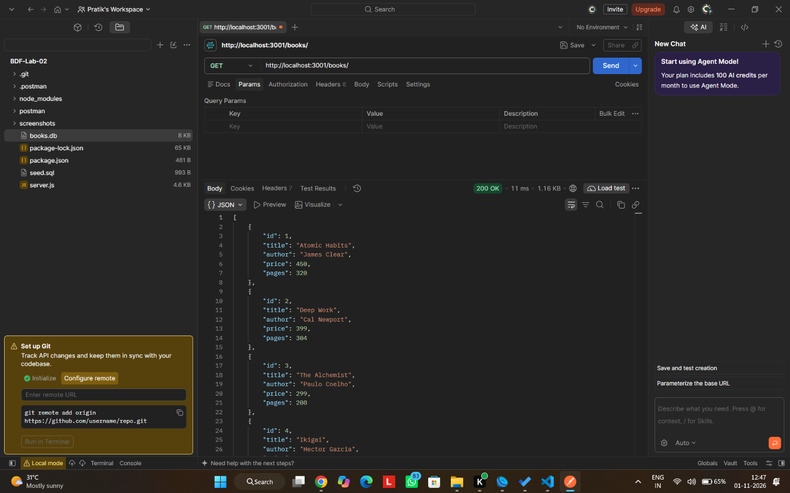
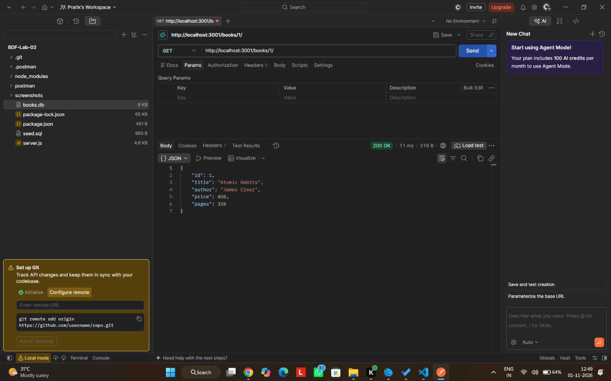
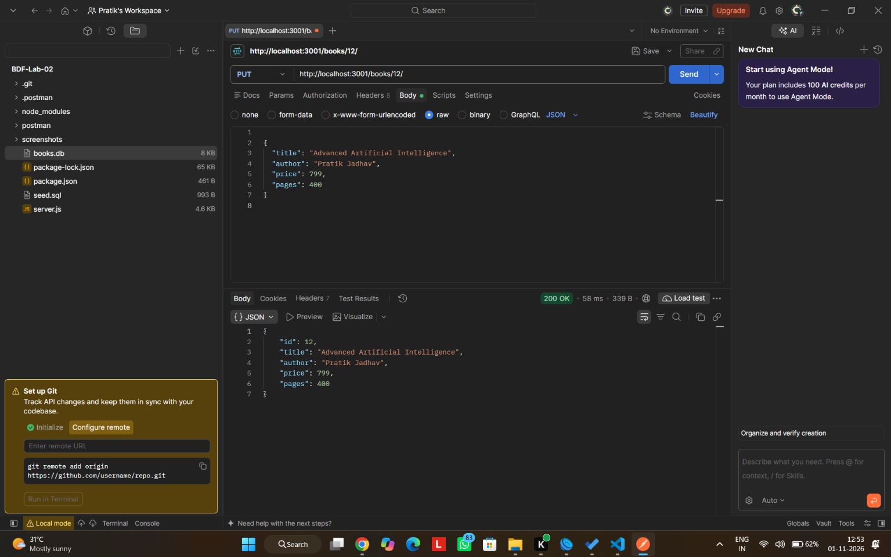
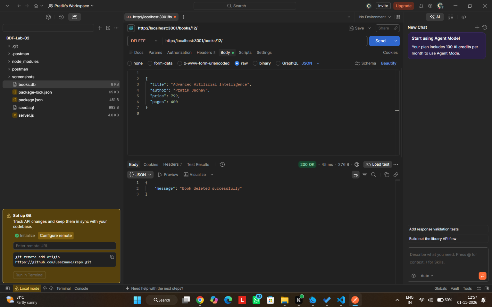
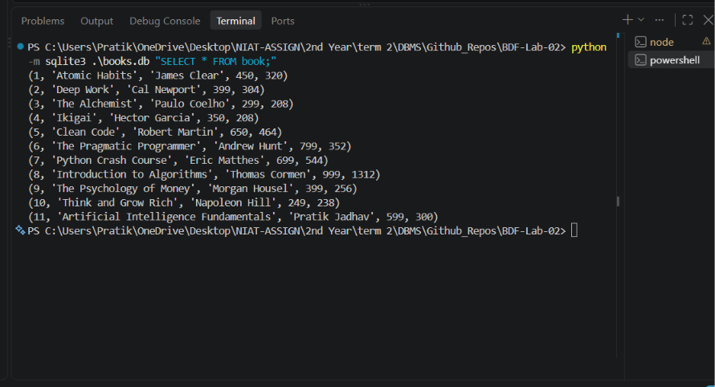

# BDF Lab 2 - SQLite Database and CRUD Routes

**Student:** Pratik Jadhav  
**Registration Number:** 252U1R5055  
**Section:** S-10  
**Department:** Artificial Intelligence and Data Engineering  
**University:** Aurora Higher Education and Research Academy  
**Course:** Backend Development Fundamentals  
**Faculty:** Sai Shiva Teja Sir  

**Live Deployment:** Pending Render deployment

## Objective

Connect a Node.js and Express.js server to a SQLite database and implement five CRUD API endpoints for managing book records.

## Technologies Used

- Node.js
- Express.js
- SQLite
- JavaScript
- npm
- Nodemon
- Postman
- Git and GitHub
- Render

## Project Files

- server.js - Express server and CRUD routes
- seed.sql - Database table and initial book records
- books.db - SQLite database
- package.json - Project settings and dependencies
- package-lock.json - Dependency lock file
- .gitignore - Excludes generated and sensitive files
- screenshots/ - Postman and SQLite testing evidence

## Installation

Clone the repository and install dependencies:

```bash
npm install
```

## Run the Project

For development using Nodemon:

```bash
npm run dev
```

For normal execution:

```bash
npm start
```

Local server: http://localhost:3001

No environment variables are required for local execution.
The optional PORT variable can override the default port.

## Database

Database: books.db

Table: book

Columns:

- id INTEGER PRIMARY KEY
- title TEXT
- author TEXT
- price INTEGER
- pages INTEGER

The database is initialized using the asynchronous
initializeDBAndServer() function.

Ten initial book records were inserted using the SQLite CLI.

## API Endpoints

| Method | Path | Description | Expected Status |
|---|---|---|---|
| GET | /books/ | Retrieve all books | 200 |
| GET | /books/:bookId/ | Retrieve one book | 200 |
| POST | /books/ | Add a new book | 201 |
| PUT | /books/:bookId/ | Update an existing book | 200 |
| DELETE | /books/:bookId/ | Delete a book | 200 |

Unknown books return HTTP 404.
Invalid book details return HTTP 400.

## Example POST Body

```json
{
  "title": "Artificial Intelligence Fundamentals",
  "author": "Pratik Jadhav",
  "price": 599,
  "pages": 300
}
```

## SQL Queries

The application uses:

- SELECT - Retrieve book records
- INSERT - Add a new book
- UPDATE - Modify an existing book
- DELETE - Remove a book

SQL queries accepting user input use ? placeholders
to prevent user-supplied values from changing SQL syntax.

## Testing Evidence

### 1. GET All Books



### 2. GET One Book



### 3. POST Add Book


### 4. PUT Update Book



### 5. DELETE Book



### 6. SQLite Database View



## Deployment

Platform: Render  
Service: Node.js Web Service  
Build Command: npm install  
Start Command: npm start  

The application supports the PORT environment variable.

Note: On Render's Free plan, SQLite file changes are
not preserved across service restarts or redeployments.
The committed database is used as initial demonstration data.

## Notes

- Nodemon restarts the server when source files change.
- Async/await is used for database operations.
- Parameterized SQL queries are used for user inputs.
- The database must connect before the server starts.
- Postman is used to test all five CRUD endpoints.
- SQLite CLI is used to inspect database records.
- node_modules and .env are excluded from Git.

## Result

Implemented an Express.js Book Management API using
SQLite with five CRUD endpoints.

The project includes its SQLite database, seeded records,
source code, and Postman screenshots.

## Conclusion

This project demonstrates relational database integration
with Node.js and Express.js, including CRUD operations,
asynchronous database access, SQL parameterization,
HTTP status codes, and API testing.

---

**Developed by Pratik Jadhav**  
**Registration Number: 252U1R5055**  
**Section: S-10**
